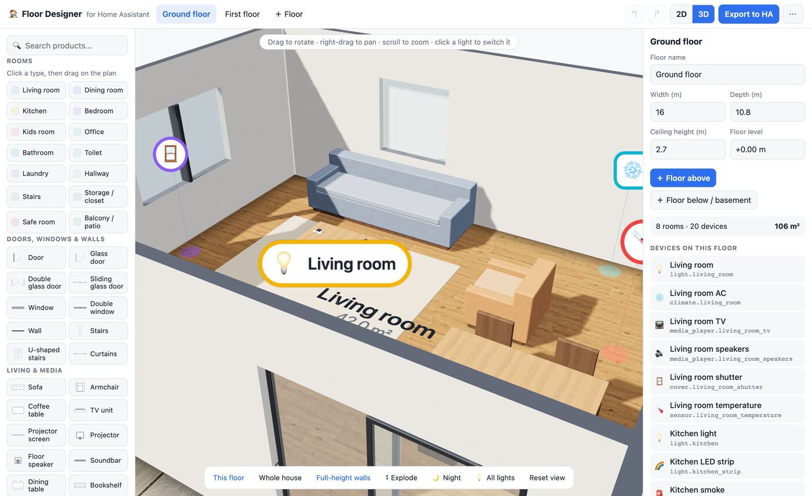

# 🏠 Home 3D Studio

**Draw your home in 2D, walk through it in 3D, and plan where every light, switch, AC and camera goes.**
Free, in your browser, no sign-up.

👉 **Try it: https://carmelbd.github.io/home3d-studio/**



## What you can do

- **Draw floor plans.** Add rooms, doors, windows, stairs and several floors. Walls snap into place.
- **See it in 3D instantly.** Orbit around, cut the walls to look inside, explode the floors, or turn on night mode.
- **Furnish it.** Kitchens, beds, sofas, dining sets, ceiling fans, pools and gates, with wood finishes and colors.
- **Plan a smart home.** Place lights, switches, ACs, curtains, speakers and cameras, and try them in Preview mode.
- **HD realism (Studio only).** Full-resolution rendering, 2K photo textures, crisp tiles and ambient occlusion (soft shading in corners and under furniture). Turn it off with **✨ HD** in the 3D bar if a device feels slow.
- **Keep your work.** Designs save in your browser automatically. Use **⋯ → Save design file** to download a copy and open it on another device.

## Have Home Assistant?

The same designer is available as a Home Assistant card: **[ha-home-3d](https://github.com/carmelbd/ha-home-3d)**.
Install it through HACS and your plan becomes a live 3D dashboard that controls your home.
A design file saved here opens there too.

## How this repo works

The designer itself is developed in [ha-home-3d](https://github.com/carmelbd/ha-home-3d) (`floor-designer.html`).
This repo is the public website:

| Path | What it is |
| --- | --- |
| `index.html` | The landing page |
| `app/index.html` | The designer in web mode. **Built, do not edit by hand.** |
| `build.py` | Copies the designer from ha-home-3d, switches it to web mode and adds the HD renderer |
| `img/` | Screenshots |

To update the site after a designer change:

```sh
# with ha-home-3d checked out next to this repo
python3 build.py
git commit -am "Update designer" && git push
```

GitHub Pages publishes the `main` branch automatically.

## License

MIT
